<p align="center">
  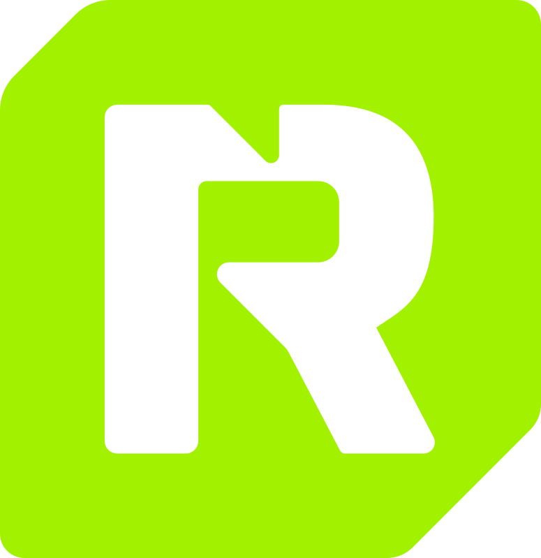
</p>

<h1 align="center">RODAR Keycloak</h1>

<p align="center">
  <a href="https://github.com/rodarglobal/rodar-keycloak/actions/workflows/ci.yml"></a>
</p>

<p align="center">
  <strong>O agente de voz que conecta motorista, recebedor e central de operação (CCO).</strong><br />
  Este repositório é a <strong>identidade e o acesso</strong> do RODAR: o <strong>Keycloak</strong> que faz o login do app e do painel, organiza as transportadoras e traz a marca RODAR.
</p>

<p align="center">
  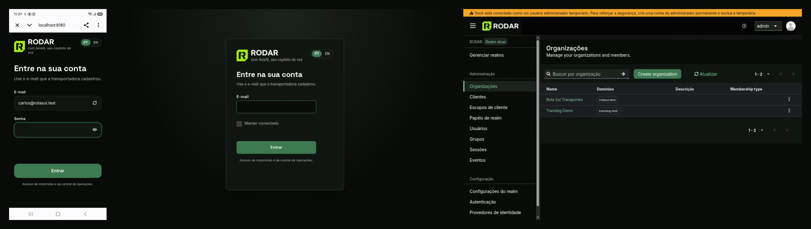
</p>

<p align="center">
  <sub>Ambiente local, com dados fictícios. À esquerda, captura do app do motorista num Android real; ao centro, o login em tela larga; à direita, o console de administração.</sub>
</p>

## Para o júri

| | |
|---|---|
| **Trilha** | Logística & automação |
| **Em uma frase** | Um login só para o motorista e para a central, com cada transportadora como uma organização e o motorista agregado com uma conta para todas. |
| **Estrutura** | Um realm `rodar` por ambiente · cada produto é um client · cada transportadora é uma Organization ([por quê](docs/adr/0001-estrutura-realm-clients-organizations.md)) |
| **Repositórios** | [rodar-backend](https://github.com/rodarglobal/rodar-backend) · [rodar-web](https://github.com/rodarglobal/rodar-web) · [rodar-mobile](https://github.com/rodarglobal/rodar-mobile) · [rodar-keycloak](https://github.com/rodarglobal/rodar-keycloak) (este) |
| **Qualidade** | CI sobe o Keycloak de verdade a cada push e PR, aplica temas e empresas e faz o login do app com PKCE para três perfis, conferindo papéis, empresas e o tema |
| **Segurança** | Authorization Code + PKCE, sem password grant · token com audiência `rodar-api` · proteção contra força bruta · token sem dados do negócio ([detalhes](#segurança)) |
| **O que é simulado** | usuários e transportadoras fictícios, senha única de teste e Keycloak em modo de desenvolvimento: [lista completa](#o-que-é-simulado) |
| **Glossário** | **realm**: o espaço de usuários e configurações do Keycloak · **client**: um app que pede login (o app do motorista, o painel) · **Organization**: uma empresa dentro do realm · **PKCE**: proteção do login de apps que não guardam segredo · **agregado**: motorista autônomo que roda para mais de uma transportadora |

## Para que serve

O motorista e o operador da central entram uma vez só, pela tela com a marca RODAR. O Keycloak diz aos apps e ao backend **quem é a pessoa, o que ela é e para quais transportadoras trabalha**; o resto fica no backend.

| | Pilar | Como o Keycloak entrega |
|---|---|---|
| 🔐 | **Um login para tudo** | App do motorista e painel do CCO são clients do mesmo realm `rodar`: uma conta, uma sessão, um lugar para trocar senha ou bloquear acesso. |
| 🏢 | **Transportadora em uma linha** | Cada cliente é uma Organization. Cadastrar uma transportadora é acrescentar uma linha em `realm/organizations.conf`, não configurar um realm inteiro. |
| 🚚 | **Agregado com uma conta só** | O mesmo motorista pode ser membro de várias transportadoras, e o token traz todas. O backend sabe de qual empresa é cada viagem. |
| 🧾 | **Token enxuto** | Só identidade, papéis (`driver`, `cco-operator`, `cco-admin`) e empresas. Viagem, motorista e veículo ficam no backend, sempre atualizados. |
| 🎨 | **Marca RODAR de ponta a ponta** | Login, troca de idioma (PT/EN) e console de administração com os mesmos tokens e fontes do app e do painel web. |

## Como funciona

O fluxograma mostra o login do motorista, do toque em **Entrar** até a rota na tela. Em seguida, abra cada etapa para ver a tela correspondente.

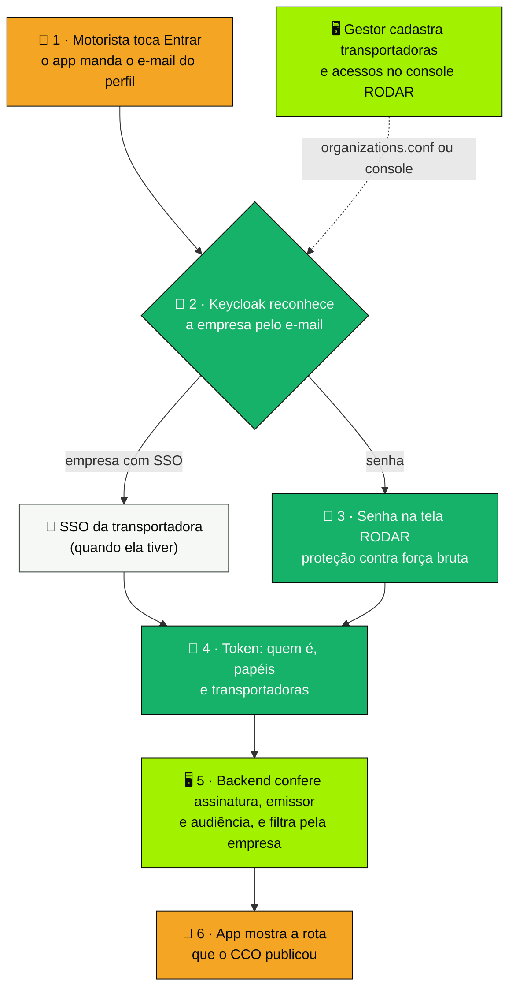

<sub>Cores por papel: 🟩 lima = CCO e backend · 🟢 verde = Keycloak · 🟧 âmbar = motorista e app · ⬜ claro = sistema da transportadora.</sub>

<details>
<summary><strong>1 e 2 · O app abre o login e o Keycloak reconhece a empresa</strong></summary>
<br />

O app abre o login no navegador do sistema com o client `rodar-mobile` (Authorization Code + PKCE) e manda o e-mail do perfil escolhido. Com Organizations ligado, o login tem duas etapas: primeiro o e-mail, para o Keycloak achar a empresa e, se ela tiver SSO próprio, mandar a pessoa para lá; depois a senha. Como o app já manda o e-mail, o motorista vai direto para a senha.

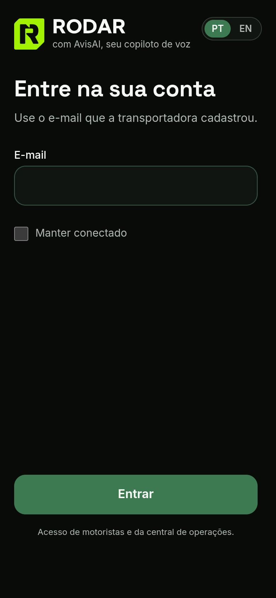
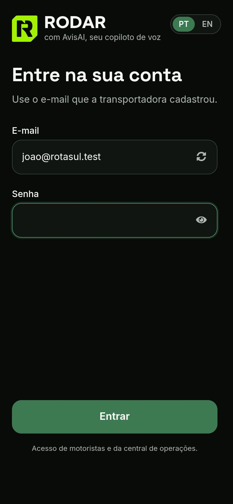
</details>

<details>
<summary><strong>3 · A senha na tela RODAR</strong> (no celular)</summary>
<br />

A tela é a mesma do app: fundo quase preto, assinatura RODAR com "com AvisAI, seu copiloto de voz", campos e botão de 56 px. Erro de senha aparece com borda, ícone e texto, sem depender só da cor.

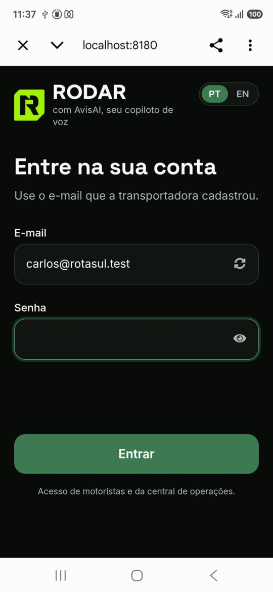
</details>

<details>
<summary><strong>4 a 6 · Token, backend e a rota na tela</strong></summary>
<br />

O app troca o código pelos tokens. O token traz `sub`, nome, e-mail, `roles` e `organization` (com o escopo `organization:*`, todas as transportadoras da pessoa). O app busca motorista e viagem no backend pelo e-mail e mostra a rota. O backend deve conferir assinatura (JWKS), emissor e audiência `rodar-api`, e filtrar tudo pela empresa ([contrato completo](docs/ESTRUTURA.md#o-que-o-token-traz)).

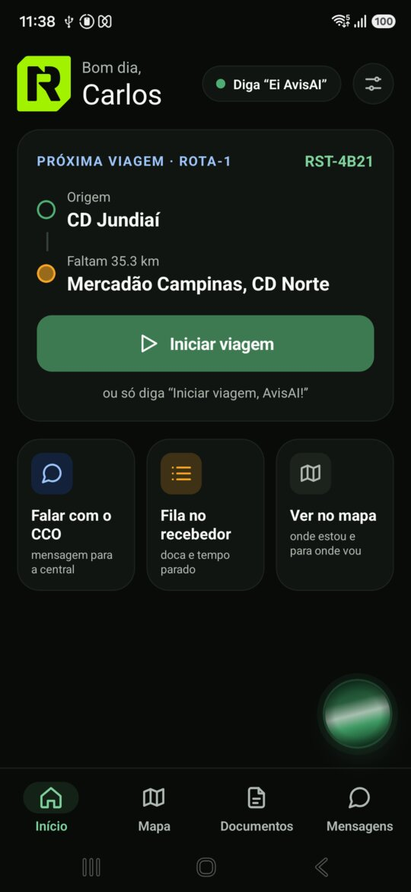
</details>

<details>
<summary><strong>Gestão · Transportadoras, clients e acessos no console</strong></summary>
<br />

O console de administração tem logo, ícone, título e cores do RODAR. As transportadoras ficam em **Organizações**; os produtos, em **Clientes**. No ambiente local, as empresas vêm de `realm/organizations.conf`.

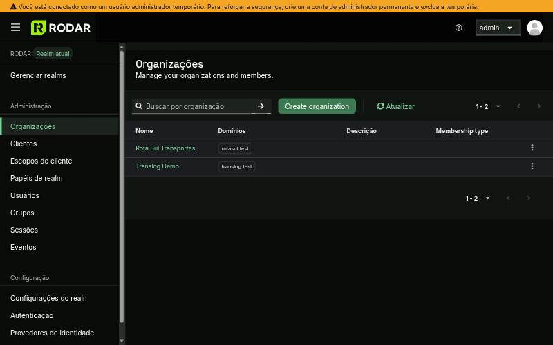
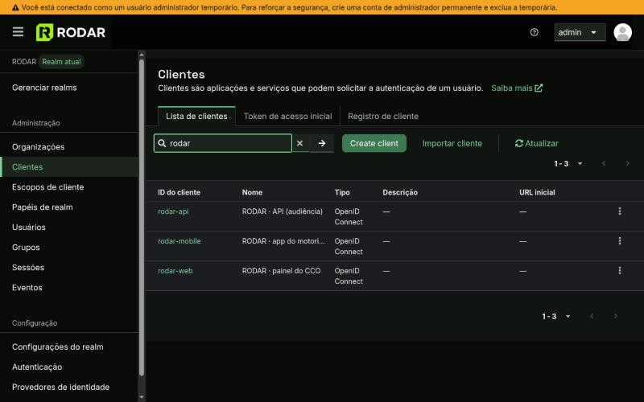
</details>

## Telas

<table>
  <tr>
    <td width="33%"><br /><sub><b>Login</b> · celular: etapa do e-mail</sub></td>
    <td width="33%"><br /><sub><b>Login</b> · celular: etapa da senha (e-mail vindo do app)</sub></td>
    <td width="33%"><br /><sub><b>No aparelho</b> · Android real, aberto pelo app</sub></td>
  </tr>
  <tr>
    <td>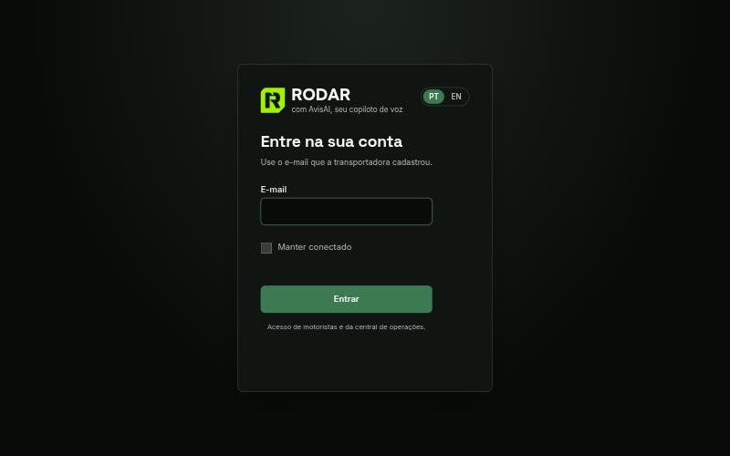<br /><sub><b>Login</b> · tela larga, no padrão do painel web</sub></td>
    <td>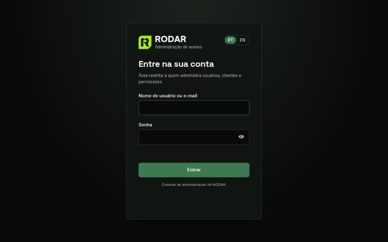<br /><sub><b>Console</b> · login de administração (realm <code>master</code>)</sub></td>
    <td><br /><sub><b>Console</b> · Organizações (transportadoras)</sub></td>
  </tr>
</table>

## Estrutura

```text
master   só administração do Keycloak (temas RODAR no login e no console)
rodar    realm do produto, um por ambiente
├── clients        rodar-mobile · rodar-web · rodar-api       → um por produto
├── organizations  rota-sul · translog-demo                    → uma por transportadora
├── papéis         driver · cco-operator · cco-admin           → o que a pessoa é
└── tema           rodar
```

| Client | Tipo | Uso |
|---|---|---|
| `rodar-mobile` | público, Authorization Code + PKCE (S256), sem password grant | App do motorista. Redirects `avisai://*` (scheme atual), `rodar://*` e `exp://*` (Expo Go). |
| `rodar-web` | público, Authorization Code + PKCE (S256) | Painel do CCO (`http://localhost:5173` no Vite). |
| `rodar-api` | só audiência | O access token sai com `aud: rodar-api`; o backend recusa token sem ela. |

**Por que não um realm por empresa ou por produto?** Com um realm por empresa, o agregado teria uma conta em cada transportadora, o app precisaria perguntar a empresa antes do login e cada cliente novo seria um realm inteiro para manter. Com um realm por produto, o operador perderia o login único entre o painel e os próximos produtos. A decisão completa está na [ADR 0001](docs/adr/0001-estrutura-realm-clients-organizations.md); o guia com token, fluxo e operações, em [ESTRUTURA.md](docs/ESTRUTURA.md).

## Rodar localmente

Use Docker com Compose.

```bash
cp .env.example .env
```

```bash
docker compose up -d
```

```bash
./scripts/smoke.sh
```

O `docker compose up` sobe Keycloak 26.4 e Postgres; o serviço `kc-setup` espera o Keycloak ficar pronto, aplica os temas no realm `master` e as transportadoras do `realm/organizations.conf`, e sai. O smoke test faz o login do app (Authorization Code + PKCE) só com curl e mostra as claims; aceita `usuário senha`. O CI do GitHub faz os mesmos passos a cada push e PR.

- **Login do app:** `http://localhost:8180/realms/rodar` (issuer)
- **Console de administração:** http://localhost:8180/admin (credenciais do `.env`)

| Ajuste (`.env`) | Padrão | O que muda |
|---|---|---|
| `KC_VERSION` | `26.4` | Versão da imagem do Keycloak. Ao subir de versão, confira o console: o CSS dele depende do PatternFly. |
| `KC_PORT` | `8180` | Porta do Keycloak na máquina. |
| `KC_ADMIN_USER` / `KC_ADMIN_PASSWORD` | `admin` / `admin` | Admin temporário criado na primeira subida (só desenvolvimento). |
| `KC_DB_PASSWORD` | `keycloak` | Senha do Postgres local. |

<details>
<summary><strong>Usar no celular (app do motorista)</strong></summary>
<br />

Em `start-dev` o issuer segue o host pelo qual o Keycloak é acessado. Com o celular no USB, redirecione a porta e use `localhost`:

```bash
adb reverse tcp:8180 tcp:8180
```

No `.env` do [rodar-mobile](https://github.com/rodarglobal/rodar-mobile):

```dotenv
EXPO_PUBLIC_AUTH_MODE=keycloak
EXPO_PUBLIC_KEYCLOAK_ISSUER=http://localhost:8180/realms/rodar
EXPO_PUBLIC_KEYCLOAK_CLIENT_ID=rodar-mobile
```

Sem USB, use o IP da máquina na rede local no lugar de `localhost`.
</details>

<details>
<summary><strong>Cadastrar transportadoras e aplicar mudanças</strong></summary>
<br />

| O quê | Arquivo | Quando é aplicado |
|---|---|---|
| Realm `rodar`: clients, papéis, usuários de teste, tema | `realm/rodar-realm.json` | Só na **primeira** subida (banco vazio). |
| Transportadoras e membros | `realm/organizations.conf` | A cada `docker compose up` (cria o que falta, nunca apaga). |
| Temas do realm `master` | `scripts/configure.sh` | A cada `docker compose up`. |
| Tema de login e do console | `themes/rodar` | Na hora: em `start-dev` o cache de tema fica desligado. |

Para cadastrar uma transportadora, acrescente uma linha em `realm/organizations.conf` e rode:

```bash
docker compose up -d kc-setup
```

Mudou o `rodar-realm.json`? Recrie o banco local:

```bash
docker compose down -v && docker compose up -d
```
</details>

### Usuários de teste

Senha local `avisai-demo` para todos (só desenvolvimento).

| Usuário | Papéis | Transportadoras |
|---|---|---|
| carlos@rotasul.test | driver | rota-sul |
| marina@rotasul.test | driver | rota-sul |
| joao@rotasul.test | driver | rota-sul, translog-demo (agregado) |
| cco@rotasul.test | cco-operator | rota-sul |
| gestor@rotasul.test | cco-operator, cco-admin | rota-sul |
| ana@translog.test | driver | translog-demo |

Os motoristas batem com os perfis de demo do rodar-mobile (`src/features/auth/api/profiles.ts`).

## O que é simulado

Este repositório é o ambiente de **desenvolvimento** do Keycloak. Nele:

- **Usuários e transportadoras:** seis pessoas e duas empresas fictícias (`rotasul.test`, `translog.test`), com a mesma senha de teste.
- **Modo de desenvolvimento:** `start-dev`, HTTP sem TLS, hostname dinâmico e cache de tema desligado.
- **Admin temporário:** o usuário `admin` é criado na primeira subida; o console mostra o aviso de admin temporário.
- **SSO das transportadoras:** a estrutura suporta um provedor de identidade por Organization, mas nenhum está configurado.
- **Login por SMS:** o mockup prevê celular + código; hoje o login é por e-mail e senha.

O que é real: o fluxo OIDC com PKCE, as Organizations, os papéis, as claims do token, os temas e a aplicação idempotente das empresas.

## Segurança

- **PKCE e sem password grant:** os apps não guardam segredo e nunca veem a senha; o login acontece na tela do Keycloak, no navegador do sistema.
- **Audiência:** o access token sai com `aud: rodar-api`, para o backend recusar tokens emitidos para outros fins.
- **Força bruta:** proteção ligada no realm `rodar`.
- **Token sem dados do negócio:** nada de viagem, motorista ou veículo no token; o backend filtra tudo pela empresa (`organization`).
- **Segredos fora do git:** só `.env.example` é versionado; `.env` está no `.gitignore`.
- **Antes de produção:** `start` com HTTPS e hostname fixo, admin permanente, segredos num cofre e configuração como código ([checklist](docs/ESTRUTURA.md#ambientes-e-produção)).

## Organização do repositório

```text
.
├── docker-compose.yml        Keycloak + Postgres + kc-setup (aplica temas e empresas e sai)
├── realm/
│   ├── rodar-realm.json      realm rodar: clients, papéis, usuários de teste, tema
│   └── organizations.conf    transportadoras e membros
├── scripts/
│   ├── configure.sh          temas do master e Organizations (idempotente, roda no kc-setup)
│   └── smoke.sh              login do app com PKCE só com curl
├── themes/rodar/
│   ├── login/                tema de login: template, CSS, textos PT/EN, fontes, marca
│   └── admin/                tema do console: logo, título, cores
└── docs/
    ├── ESTRUTURA.md          guia: estrutura, token, fluxo, integração, operações
    └── adr/0001-…            decisão: realm único, clients e Organizations
```

O tema de login herda as páginas do `keycloak.v2` (senha, OTP, erro, sessão expirada) e troca só o layout e o visual; o do console troca logo, ícone, título e as variáveis de cor do PatternFly. As cores vêm dos mesmos tokens do [rodar-web](https://github.com/rodarglobal/rodar-web) (`src/index.css`) e do [rodar-mobile](https://github.com/rodarglobal/rodar-mobile) (`tailwind.config.js`).

## Documentação

- [Estrutura do Keycloak: realms, clients, Organizations, token, fluxo, integração e operações](docs/ESTRUTURA.md)
- [ADR 0001: um realm por ambiente, produtos como clients, empresas como Organizations](docs/adr/0001-estrutura-realm-clients-organizations.md)
- Integração do app: [rodar-mobile](https://github.com/rodarglobal/rodar-mobile) (`EXPO_PUBLIC_AUTH_MODE=keycloak`)

## Licença e versão

[MIT](LICENSE) · **v0.1.0**

**Histórico:** o projeto começou como *AvisAI* no hackathon UNMUTE by Agora (21–22/11/2026) e continua como **RODAR** no Hack Brasil 2026, na trilha Logística & automação. Este repositório foi criado em 25/11/2026 para o login real do app; começou com o realm `avisai` e, em 26/11, foi reorganizado no realm `rodar`, com clients por produto e transportadoras como Organizations. O AvisAI segue como o nome do agente de voz.

Repositórios: [rodar-backend](https://github.com/rodarglobal/rodar-backend) · [rodar-web](https://github.com/rodarglobal/rodar-web) · [rodar-mobile](https://github.com/rodarglobal/rodar-mobile) · este (rodar-keycloak).
