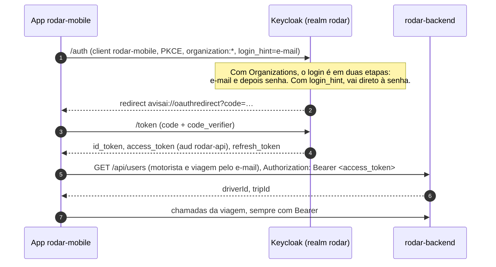

# Estrutura do Keycloak do RODAR

Guia de referência: o que existe no Keycloak, por que está assim, o que o token traz, como apps e backend se
integram e como fazer as operações do dia a dia. A decisão formal, com as alternativas descartadas, está na
[ADR 0001](adr/0001-estrutura-realm-clients-organizations.md).

## Resumo em uma tela

```text
Keycloak (uma instalação por ambiente: dev, staging, prod)
├── master   só administração do Keycloak
└── rodar    realm do produto
    ├── clients        rodar-mobile · rodar-web · rodar-api       → um por produto/superfície
    ├── organizations  rota-sul · translog-demo · …               → uma por transportadora cliente
    ├── papéis         driver · cco-operator · cco-admin          → o que a pessoa é
    └── tema           rodar                                       → login e console com a marca
```

| Pergunta | Resposta |
|---|---|
| Cada empresa é um realm? | **Não.** Empresa é uma *Organization* dentro do realm `rodar`. |
| Cada produto é um realm? | **Não.** Produto é um *client* dentro do realm `rodar`. |
| Quantos realms? | Um realm `rodar` por ambiente, mais o `master` de administração. |
| O que o token traz? | Quem é a pessoa, seus papéis e suas empresas. Nada de viagem, motorista ou veículo. |
| Quem decide o que a pessoa pode ver? | O backend, filtrando pela empresa do token. |

## Por que assim

Três fatos do negócio decidiram a estrutura:

1. **O motorista agregado roda para mais de uma transportadora.** Com um realm por empresa, ele teria uma conta e
   uma senha em cada uma. Com Organizations, tem uma conta só, membro das várias empresas.
2. **O operador do CCO usa mais de um produto.** Com um realm por produto, perderia o login único (SSO) e teria
   usuários duplicados. No Keycloak, produto é client, e todos os clients do realm compartilham a sessão.
3. **Transportadoras novas entram com frequência.** Um realm por empresa exigiria configurar e manter um realm
   inteiro (clients, temas, fluxos) a cada cliente, e o Keycloak perde desempenho com centenas de realms. Uma
   Organization é uma linha num arquivo.

Também pesou o lado técnico:

- O app do motorista tem **um endereço de login só**. Com realm por empresa, precisaria perguntar a empresa antes
  do login ou ter um endereço por cliente.
- O backend valida tokens de **um emissor só** por ambiente.
- Cada transportadora pode ter **SSO com o próprio AD/Google** ligado à sua Organization, sem afetar as outras.

**Exceção prevista:** um cliente grande que exija por contrato isolamento total, admin próprio ou marca própria pode
ganhar um realm dedicado. É exceção, não o padrão.

## Realms

| Realm | Para quê | Quem usa |
|---|---|---|
| `master` | Administrar o Keycloak (realms, clients, admins). | Só quem administra a plataforma. Nenhum app. |
| `rodar` | Identidade do produto: motoristas, operadores, gestores. | Todos os apps e o backend. |

Ambientes diferentes são **instalações diferentes** do Keycloak, cada uma com seu realm `rodar`. Nunca
`rodar-dev` e `rodar-prod` lado a lado no mesmo servidor: um erro de configuração em dev não pode tocar produção.

## Clients (produtos)

| Client | Tipo | Fluxo | Redirects | Uso |
|---|---|---|---|---|
| `rodar-mobile` | público | Authorization Code + PKCE (S256) | `avisai://*`, `rodar://*`, `exp://*` | App do motorista (Expo). `avisai://` é o scheme atual do app; `rodar://` fica pronto para a troca; `exp://` é o Expo Go. |
| `rodar-web` | público | Authorization Code + PKCE (S256) | `http://localhost:5173/*` | Painel do CCO (Vite). Em staging/prod, o domínio do painel. |
| `rodar-api` | sem login | — | — | Só **audiência**: os tokens dos apps saem com `aud: rodar-api`, e o backend recusa tokens sem ela. |

Regras de todos os clients de app:

- **Públicos com PKCE.** App não guarda segredo (qualquer um extrai de um APK ou do JavaScript do navegador).
- **Sem password grant** (`directAccessGrantsEnabled: false`). O app nunca vê a senha: o login acontece na tela do
  Keycloak, no navegador do sistema.
- **Escopos padrão:** `profile`, `email`, `roles`, `organization`, `basic`, `acr`, `web-origins`. Opcional:
  `offline_access` (o app pede, para o motorista continuar logado sem rede).
- **Mappers:** `roles` (papéis de realm na claim `roles`) e audiência `rodar-api`.

Produto novo = client novo neste realm, com as mesmas regras.

## Organizations (transportadoras)

Cada transportadora cliente é uma Organization com:

- **alias:** identificador estável que vai no token (`rota-sul`). Nunca muda depois de criado.
- **nome:** o que aparece para pessoas (`Rota Sul Transportes`).
- **domínio:** domínio do e-mail da empresa (`rotasul.test`). Serve para o Keycloak reconhecer a empresa pelo e-mail
  e, no futuro, mandar a pessoa para o SSO dela.
- **membros:** os usuários da empresa. Um usuário pode estar em várias.
- **provedor de identidade (opcional):** SSO com o AD/Google da empresa, ligado só a ela.

No ambiente local, elas vêm de [`realm/organizations.conf`](../realm/organizations.conf):

```text
# alias | nome | domínio | membros
rota-sul      | Rota Sul Transportes | rotasul.test  | carlos@… marina@… joao@… cco@… gestor@…
translog-demo | Translog Demo        | translog.test | ana@translog.test joao@rotasul.test
```

O João está nas duas: é o caso do agregado.

## Papéis

Papéis de realm dizem **o que a pessoa é**. São globais ao usuário (no Keycloak 26 não existem papéis por
Organization).

| Papel | Quem | Onde entra |
|---|---|---|
| `driver` | Motorista | App `rodar-mobile` |
| `cco-operator` | Operador da central | Painel `rodar-web` |
| `cco-admin` | Gestor da central (também tem `cco-operator`) | Painel `rodar-web`, com cadastros e usuários da empresa |

**O papel diz o que a pessoa é; a empresa diz para quem.** O que alguém pode ver e fazer *em uma empresa* é decidido
pelo backend, combinando papel e `organization`. Se um dia a mesma pessoa for motorista numa empresa e operadora em
outra, isso fica no backend.

## O que o token traz

O app pede os escopos `openid profile email offline_access organization:*`. Exemplo de ID token do João:

```json
{
  "iss": "https://<keycloak>/realms/rodar",
  "sub": "8594bca8-2e1b-47ab-8564-ce9847f8c9ba",
  "azp": "rodar-mobile",
  "name": "João Pereira",
  "email": "joao@rotasul.test",
  "roles": ["driver", "offline_access", "default-roles-rodar", "uma_authorization"],
  "organization": ["translog-demo", "rota-sul"]
}
```

O access token traz as mesmas claims e `"aud": ["rodar-api", "account"]`.

| Claim | Significado | Use para |
|---|---|---|
| `sub` | Id do usuário no Keycloak. Nunca muda. | Chave para ligar o usuário aos dados do backend. |
| `name`, `email` | Nome e e-mail. | Exibir; achar o cadastro do motorista. |
| `roles` | Papéis de realm. | Decidir em qual app/tela a pessoa entra. |
| `organization` | Aliases das empresas da pessoa. | Filtrar **todos** os dados por empresa no backend. |
| `aud` (access) | Contém `rodar-api`. | O backend recusa token sem ela. |

**O que não está no token, de propósito:** viagem (`trip_id`), motorista (`driver_id`), placa e nome da empresa
para exibição. O token dura 5 minutos e é renovado; dados que mudam durante o dia ficariam velhos nele. O app pede
isso ao backend depois do login.

### Por que `organization:*`

No Keycloak 26, a claim `organization` depende de como o app pede o escopo:

| O app pede | Resultado |
|---|---|
| nada | O token **não** traz `organization`. |
| `organization` | Quem está em várias empresas **precisa escolher uma** numa tela do Keycloak. |
| `organization:*` | O token traz **todas** as empresas da pessoa, sem tela extra. |

Usamos `organization:*`: o agregado não precisa escolher para quem vai rodar, porque o backend sabe de qual
transportadora é cada viagem.

## Fluxo de login do app



Por que o login tem duas etapas: com Organizations ligado, o Keycloak primeiro identifica a pessoa pelo e-mail. Se
a empresa dela tiver SSO próprio, ele já redireciona para lá; se não, pede a senha.

## Como cada parte se integra

### App (`rodar-mobile`)

- `EXPO_PUBLIC_AUTH_MODE=keycloak`, `EXPO_PUBLIC_KEYCLOAK_ISSUER=<keycloak>/realms/rodar`,
  `EXPO_PUBLIC_KEYCLOAK_CLIENT_ID=rodar-mobile`.
- Escopos em `src/lib/config.ts` (`KEYCLOAK_SCOPES`), com `organization:*`.
- Manda o e-mail do perfil escolhido como `login_hint`.
- Claims → sessão em `src/features/auth/api/claims.ts`; motorista e viagem vêm do perfil do backend
  (`withDriverProfile`), pelo e-mail.

### Painel (`rodar-web`), pendente

Mesmo padrão com o client `rodar-web`: Authorization Code + PKCE, `organization:*`, papel `cco-operator` ou
`cco-admin` para entrar.

### Backend (`rodar-backend`), pendente

Para cada requisição:

1. Validar a **assinatura** pelo JWKS: `<keycloak>/realms/rodar/protocol/openid-connect/certs` (com cache).
2. Conferir `iss` igual ao realm `rodar` **do ambiente**.
3. Conferir que `aud` contém `rodar-api` e que o token não expirou.
4. Ler `roles` para autorizar a rota da API (motorista, operador, gestor).
5. Filtrar **toda consulta** pelas empresas de `organization`. Nunca confiar em empresa enviada pelo cliente no corpo
   ou na URL.
6. Ligar o usuário aos dados do negócio pelo `sub` (ou pelo e-mail enquanto o cadastro não tiver o `sub`).

## Onde cada coisa é configurada

| O quê | Arquivo | Quando é aplicado |
|---|---|---|
| Realm `rodar`: clients, papéis, usuários de teste, tema, Organizations ligado | [`realm/rodar-realm.json`](../realm/rodar-realm.json) | Só na **primeira** subida (banco vazio). |
| Transportadoras e membros | [`realm/organizations.conf`](../realm/organizations.conf) | A cada `docker compose up` (`kc-setup`). Cria o que falta, nunca apaga. |
| Temas do realm `master` | [`scripts/configure.sh`](../scripts/configure.sh) | A cada `docker compose up` (`kc-setup`). |
| Tema de login e do console | [`themes/rodar`](../themes/rodar) | Na hora (em `start-dev` o cache de tema fica desligado). |

## Operações

| Quero… | Faço |
|---|---|
| Cadastrar uma transportadora | Acrescento uma linha em `realm/organizations.conf` e rodo `docker compose up -d kc-setup`. |
| Pôr alguém numa transportadora | Acrescento o e-mail na linha dela e rodo `docker compose up -d kc-setup`. |
| Criar um usuário | Em dev: no `rodar-realm.json` (e recrio o banco) ou pelo console. Em produção: pelo console ou API de admin. |
| Criar um produto novo | Client novo no realm `rodar` (público + PKCE se for app), com os mappers `roles` e audiência `rodar-api`. |
| Criar um papel | Papel de realm no `rodar-realm.json` e a regra correspondente no backend. |
| Ligar SSO de uma transportadora | Provedor de identidade (OIDC/SAML) ligado à Organization dela, com o domínio do e-mail. |
| Aplicar uma mudança no `rodar-realm.json` | Em dev: `docker compose down -v && docker compose up -d` (recria o banco). |
| Conferir que está tudo certo | `./scripts/smoke.sh [usuário] [senha]`: faz o login do app só com curl e mostra as claims. |

## Ambientes e produção

O ambiente local usa `start-dev`, HTTP e o admin temporário criado na primeira subida. Antes de staging/prod:

- `start` (modo produção) com **HTTPS** e **hostname fixo**: o `iss` do token precisa ser estável para o backend.
- **Admin permanente** no lugar do admin temporário do bootstrap; segredos fora de arquivos.
- **Configuração como código** que se aplica a cada deploy (o import de JSON só vale para banco vazio):
  avaliar `keycloak-config-cli` ou o provider Terraform do Keycloak.
- Redirects dos clients com os domínios reais (o painel em staging/prod, o scheme definitivo do app).
- Sem os usuários de teste.

## Decisões em aberto

- **Como o motorista entra:** o mockup prevê celular + código por SMS. O Keycloak não tem SMS pronto: extensão da
  comunidade, autenticador próprio, código por e-mail ou senha.
- **Scheme do app:** trocar `avisai://` por `rodar://` (o client já aceita os dois).
- **Ferramenta de configuração como código** para staging/prod.
